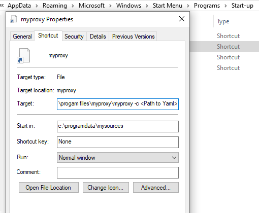

# GO myproxy proxy server based on httpproxy library

This is a proxy intended to be run in a user's context to be able to pass the user's authentication details to upstream proxies.

It can read a Proxy Auto-Configuration file from local disk or a Web Server to determine the upstrem proxy or to go direct.

On Linux a user's Kerberos credentials can be provided or myproxy can read a user's Kerberos cache file ( FILE: format only for now ) for upstream proxy Negotiate authentication.
On Linux a user's NTLM credentials can also be provided for upstream proxy NTLM authentication.

On Windows myproxy will use the SSPI interface i.e. no need to provide credentials for upstream proxy Negotiate and NTLM authentication. But if myproxy is run as a windows service the credentials will need to be provided for the service to logon with.

myproxy also supports upstrem proxy Basic authentication on Linux and Windows.

myproxy can read user passwords during startup instead of reading from YAML file.
myproxy logs to either stdout, a logfile, syslog(Linux) or event log(Windows). If run as a Windows service stdout is logged to c:\temp\myproxy_stdout.log.

On a multiuser system mproxy can use proxy Basic authentication to limit access to the myproxy port ( should only be used when listening on localhost ).

The websocket, mitm, etc yaml input files set in the main configuration are monitored i.e. any changes will be applied w/o restarting myproxy.

## Installing

```sh
git clone https://github.com/MMNetworks/myproxy.git

cd myproxy
go mod init myproxy
go mod tidy
go build myproxy.go version.go

```

### Linux

There are multiple ways to run myproxy. One option is to run it under systemd.  

Create a myproxy.service file in $HOME/.config/systemd/user

```sh
[Unit]
Description=Daemon for myproxy User Services

[Service]
Type=simple
#User=
#Group=
#ExecReload=/bin/kill -HUP $MAINPID
ExecStart=%h/.config/myproxy/bin/myproxy -c %h/.config/myproxy/conf/myproxy.yaml
Restart=on-failure
StandardOutput=file:%h/.config/myproxy/log/myproxy_%u.log

[Install]
WantedBy=default.target
```

Create the following directory structure:

$HOME/.config/myproxy  
$HOME/.config/myproxy/bin  
$HOME/.config/myproxy/log  
$HOME/.config/myproxy/conf  

Copy the myproxy binary file into $HOME/.config/myproxy/bin  
Copy the myproxy YAML config file into $HOME/.config/myproxy/conf  
Make the YAML file only accessible by the user if passwords are kept in it  
Copy the PAC file into $HOME/.config/myproxy/conf if used  

Run:
  
systemctl --user daemon-reload  
systemctl --user enable myproxy.service

The proxy should start when the user logs into the system  

if it doesn't you can start manually with:  

systemctl --user start myproxy.service  

P.S. Make sure that each user uses a different localhost port.

### Windows

The easiest way is to start myproxy during system startup when the user logs in. i.e. create a myproxy shortcut in the start-up directory



myproxy can also be started as a service using the -a option. e.g.

myproxy.exe -a install  
myproxy.exe -a start

The service options are: install, start, autostart, manualstart, stop, pause, continue, status and remove.

The install will create the service as a manual started service. autostart and manualstart options will toggle this setting.

If started manually via the Service UI the start paramters -c \<configfile\> have to be provided.

### MacOS

On MacOS, you can run `myproxy` as a launchd service (agent) in your own user account, no need for root privileges.

First, create a `~/Library/LaunchAgents` directory.

Then create a plist file with a unique name (`com.${USER}.myproxy.plist` for instance) with the following contents:

```xml
<?xml version="1.0" encoding="UTF-8"?>
http://www.apple.com/DTDs/PropertyList-1.0.dtd">
<plist version="1.0">
<dict>
        <key>label</key>
        <string>com.<your-username>.myproxy</string>

        <key>ProgramArguments</key>
        <array>
                <string>/Users/<your-username>/bin/myproxy</string>
                <string>-c</string>
                <string>/Users/.config/myproxy/config/myprox.yaml</string>
        </array>

        <key>RunAtLoad</key>
        <true/>

        <key>KeepAlive</key>
        <true/>

        <key>StandardOutPath</key>
        <string>/tmp/myproxy.out</string>

        <key>StandardErrorPath</key>
        <string>/tmp/myproxy.err</string>
</dict>
</plist>

```

To install the service, run `launchctl bootstrap gui/$(id -u) ~/Library/LaunchAgents/com.${USER}.proxy.plist`.

Please note that if you get any `launchctl` errors, you might need to `launchctl bootout gui/$(id -u) ~/Library/LaunchAgents/com.${USER}.proxy.plist` and bootstrap again because MacOS caches your plist file and won't be getting the fix.

## Usage

Configuration is stored in a YAML file and can be supplied with a -c argument  

When using myproxy as Windows service make sure the file paths are absolute paths.

- logging:
  - setting for proxy logging. Default stdout and info level and no function call trace

- pac:
  - setting for pac file. Reading from URL or FILE. Supports a proxy if PAC file is behind a proxy

- proxy:
  - settings for upstream proxy. List of supported authentication methods in order of preference
  - LocalBasicUser and LocalBasicHash is used to authenticate to this proxy. Hash is created by createPwHash

- connection:
  - setting for connection timeouts. readtimeout(deafult = 0) can enable longstanding session e.g. websockets. For granular control see websocket settings
  - When dns servers are specified the proxies own dial function is used instead of golangs default. The dns servers will be queried in parallel for fastest response ( no retry). The dialer tries connections over IPv6 first and then IPv4. If fallbackdelay is <= 0 the fastest response is selected from available IPv6 and IPv4 ips otherwise IPv4 will be delayed by fallbackdelay in milliseconds. The dialer can be limited to IPv6 or IPv4 only.
  - It supports DoT when prefixing DNS resolver IP with tls://
  - When selecting a DoH service i.e. prefix the DNS resolver with https:// it can be used over an upstream proxy. Any DNS loops will be avoided
  - You can select openDNS dns servers to apply category filtering.
  - hostsfile is used for adding local ip mappings (uses system hosts file as default before configured DNS servers)
  - hostsfirst is a boolean to define if hosts file is used before DNS ( default false)
  - hostsonly is a boolean to use only a hosts file. (default false)

- mitm:
  - settings for TLS break of proxy connection.(default disabled)
  - needs either a string with key and certificate or file names pointing to a key and certficate
  - The rules list can be used to bypass TLS break
    - the IP is the source IP or subnet to include for TLS break or exclude if prefixed with !
    - the client value determines if the source IP is the connection IP or forwarded IP. If set to client the source IP is only the connection IP. When set to proxy the forwarded IP is set as source IP. (i.e. connection IP is likely a downstream proxy). As default both IPs are checked against
    - the regex is a regex to match the URL against.
    - the tlsconfig details are used for the proxy as a TLS client. When MITM is enabled the proxy needs to verify the server cert instead of the client. This helps to limit selfsigned certificate checks to particular destinations.
    - The rules file content will be appended to the rules list ( format as above )

- wireshark:
  - settings for wireshark listen ip and port. You can connect using wireshark -k -i TCP@&lt;ip&gt;:&lt;port&gt;
  - The rules list and the rules files can be used to limit access to wireshark listening port
  - There is also an option to send the unmasked websocket traffic to wireshark instead of the masked traffic

- clamd:
  - settings for clamd connection. This can be a unix socket or over TCP and HTTPS. Client cert and key has to be provided for mTLS to the provided HTTPS server which converts HTTPS requests into clamd. This was added to make sure remote clamd connections are protected and authenticated which is not possible with plain TCP connections natively supported by clamd.
  - clamd has also a setting to block virus infected traffic or only report and a setting to block when clamd is unavailable

- websocket:
  - settings to control websocket usage. The include/exclude list can be used to enable websocket per client and URL with a timeout. A timeout of 0 basically disables websockets. A default timeout can be set using the timeout setting. Websocket connections will also be inspected when MITM is set. Thw maximim websocket packet length can be set
    - the IP is source IP or subnet to include for websocket use or exclude if prefixed with !
    - the client value determines if the source IP is the connection IP or forwarded IP. If set to client the source IP is only the connection IP. When set to proxy the forwarded IP is set as source IP. (i.e. connection IP is likely a downstream proxy). As default both IPs are checked against
    - the regex is a regex to match the URL against.
    - the timout is a timeout value in seconds
  - The rules file content will be appended to the rules list ( format as above )

- rewrite:
  - requestheader - Modifies request header send to server for http and https if MITM is enabled
    - regex - rewrite only for matching uri (including path for http and https with MITM)
    - header - header to modify. Be aware duplicate headers lines are treated with the same sed rules.
    - sed - list of sed rules. An empty source pattern means adding a new header and an empty destination pattern deletes a header. A g at the end of the sed string means replace all occurences not only the first.
  - responseheader - Modifies response header received from serverfor http and https if MITM is enabled
    - regex - rewrite only for matching uri (including path for http and https with MITM)
    - header - header to modify. Be aware duplicate headers lines are treated with the same sed rules.
    - sed - list of sed rules. An empty source pattern means adding a new header and an empty destination pattern deletes a header. A g at the end of the sed string means replace all occurences not only the first.

- tlsconfig:
  - Allows to set client and server certificate where needed as well as general TLS parameters like minimal , maximal TLS versions as well as curve and cipher selections. A CA bundle starting with + will be added to the system certificate bundle otherwise not.
    - CAbundle - Certificate Authority bundle file or "insecure" to ignore certificate check
    - minVersion - Minimum TLS version
    - maxVersion - Maximum TLS verison
    - curveIDs - List of accepted curve IDs
    - cipherIDs - List of accepted cipher IDs
    - clientKey - Client certificate key as string
    - clientCert - Client certificate as string
    - clientKeyfile - Client certificate key file
    - clientCertfile - Client certificate file
    - serverKey - Server certificate key as string
    - serverCert - Server certificate as string
    - serverKeyfile - Server certificate key file
    - serverCertfile - Server certificate file

- ftp:
  - setting default username / password for ftp. Default is anonymous / anonymous@myproxy

## YAML File format

```yaml
listen:
  ip: 127.0.0.1
  port: 9080
  tls: false
  tlsconfig:
    servercertfile: "rootCA.crt"
    serverkeyfile: "rootCA.key"
    minversion: "TLS12"
    maxversion: "TLS13"
    curveid:
      - "X25519"
      - "P256"
    cipherid:
      - "TLS_ECDHE_ECDSA_WITH_CHACHA20_POLY1305_SHA256"
      - "TLS_ECDHE_RSA_WITH_AES_128_CBC_SHA256"
    cabundle: "insecure"
  readtimeout: 0
  readtheaderimeout: 0
  writetimeout: 0
  idletimeout: 300
wireshark:
  enable: true
  unmaskedwebsocket: true
  ip: 127.0.0.1
  port: 19000
  rulesfile: "wiresharkips.txt"
  rules:
     - "127.0.0.1/32"
clamd:
  enable: true
  block: true
  blockonerror: true
  connection: "unix:/var/run/clamav/clamd.ctl"
  tlsconfig:
    clientcertfile: "clientcert.pem"
    clientkeyfile: "clientkey.pem"
    cabundle: "rootca.pem"
logging:
  level: "debug"
  file: "log_9080"
  trace: false
  accesslog: "access.log"
  milliseconds: true 
connection:
  hostsfile: "/etc/hosts"
  hostsfirst: true
  hostsonly: false
  dnsservers: 
    - "tls://1.1.1.1"
    - "tls://8.8.8.8"
    - "https://dns.google"
    - "https://cloudflare-dns.com"
    - "https://dns.quad9.net"
    - "https://dns.adguard.com"
    - "https://dns.nextdns.io"
    - "1.1.1.1"
    - "8.8.8.8"
  tlsconfig:
    cabundle: "+myrootca.pem"
  dnstimeout: 2
  fallbackdelay: 300
  ipv6: true
  ipv4: true
  readtimeout: 0
  timeout: 5
  keepalive: 5
websocket:
  maxplength: 1048560
  timeout: 10
  rulesfile: "websocketrules.yaml"
  rules:
   - ip:  "127.0.0.1/32"
     client: "client"
     regex: ".*"
     timeout: 30
   - ip:  "192.168.0.0/16"
     regex: ".*"
     timeout: 60
ftp:
  username: "ftp"
  password: "anonymous@ftp.com"
mitm:
  enable: false
  tlsconfig:
    serverkey: ""
    servercert: ""
    serverkeyfile: "key.pem"
    servercertfile: "cert.pem"
  rulesfile: "mitmrules.yaml"
  rules: 
    - ip: "::1"
      client: "client"
      regex: ".*"
      tlsconfig:
        cabundle: "insecure"
    - ip: "!100.10.10.0/24"
      regex: ".*"
      tlsconfig:
        cabundle: "selfsignedCA"
    - ip: "192.168.1.0/24"
      regex: ".*"
      tlsconfig:
        cabundle: "insecure"
    - ip: "0.0.0.0/0
      client: "client"
      regex: ".*"
pac:
  type: "FILE"
  url: "http://pac.com/pac_file"
  file: "pac_file"
  proxy: "http://proxy.test.com:3128"
rewrite:
  requestheader:
    - regex: ".*www.google.com.*"
      header: "test"
      sed:
        - "/yes/no/"
    - regex: ".*www.google.com.*"
      header: "test2"
      sed:
        - "/no/yes/"
        - "/a/b/g"
    - regex: ".*www.google.com.*"
      header: "Added-Header"
      sed:
        - "//New/"
    - regex: ".*www.google.com.*"
      header: "Delete-Header"
      sed:
        - "/.*//"
  responseheader:
    - regex: ".*www.google.com.*"
      header: "test"
      sed:
        - "/yes/no/"
        - "//no/"
    - regex: ".*www.google.com.*"
      header: "Location"
      sed:
        - "/no/yes/"
        - "/a/b/"
    - regex: ".*www.google.com.*"
      header: "Access-Control-Allow-Origin"
      sed:
        - "/no/yes/"
        - "/a/b/"
proxy:
  authentication:
    - negotiate
    - ntlm
    - basic
  NTLMDomain: "TEST"
  NTLMUser: "testuser"
  NTLMPass: "BetterProvidedOnCLI"
  KRBDomain: "TEST.COM"
  KRBMUser: "testuser"
  KRBPass: "BetterProvidedOnCLI"
  KRBCache: "/tmp/krb5cc_testuser"
  KRBConfig: "/etc/krb5.conf"
  BasicUser: "TestUser"
  BasicPass: "BetterProvidedOnCLI"
  LocalBasicUser: "TestUser"
  LocalBasicHash: "eb97d409396a3e5392936dad92b909da6f08d8c121a45e1f088fe9768b0c0339"
```
